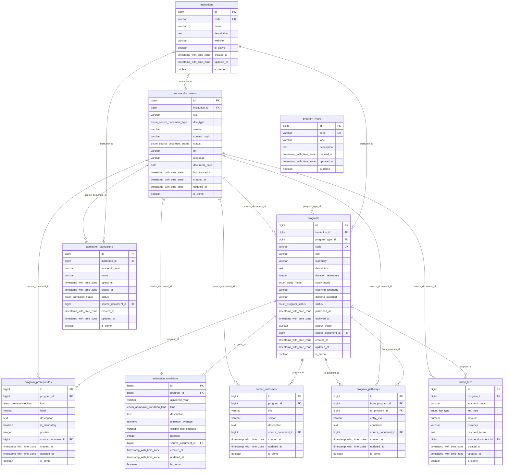
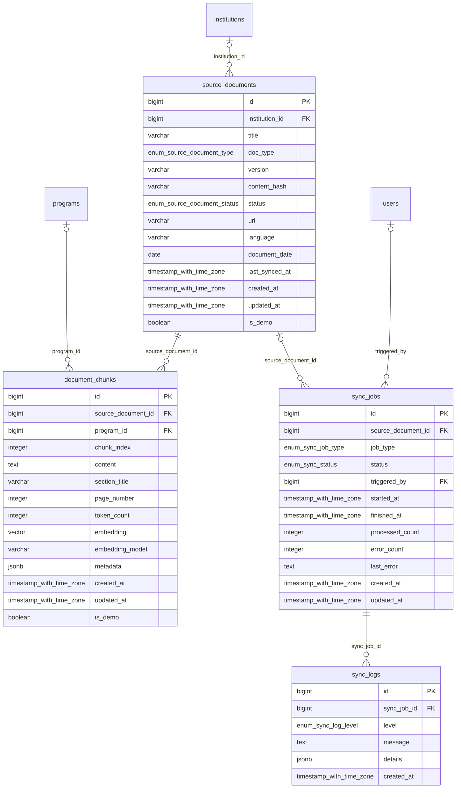

# ERD — SmartCampus AI (SA-11)

> Fichier généré par `python -m scripts.gen_docs` à partir des modèles SQLAlchemy. Ne pas éditer à la main.

Légende : `||--o{` = 1..N obligatoire, `|o--o{` = 0..1 vers N (FK nullable), `||--o|` = 1..1 (FK unique).

## SA-12 — Catalogue académique

## SA-13 — Utilisateurs et candidatures

```mermaid
erDiagram
    users {
        bigint id PK
        varchar email UK
        varchar password_hash
        varchar full_name
        boolean is_active
        boolean is_service_account
        timestamp_with_time_zone last_login_at
        timestamp_with_time_zone created_at
        timestamp_with_time_zone updated_at
        boolean is_demo
    }
    roles {
        bigint id PK
        enum_role_code code UK
        varchar label
        bigint institution_id FK
        timestamp_with_time_zone created_at
        timestamp_with_time_zone updated_at
    }
    user_roles {
        bigint user_id PK
        bigint role_id PK
        timestamp_with_time_zone granted_at
        bigint granted_by FK
    }
    candidates {
        bigint id PK
        bigint user_id FK
        varchar first_name
        varchar last_name
        varchar phone
        smallint birth_year
        varchar governorate
        timestamp_with_time_zone created_at
        timestamp_with_time_zone updated_at
        boolean is_demo
    }
    candidate_profiles {
        bigint id PK
        bigint candidate_id FK
        enum_education_level education_level
        varchar bac_section
        smallint bac_year
        numeric bac_average
        varchar current_program
        varchar interests
        varchar preferred_subjects
        text goals
        text constraints
        enum_message_language preferred_language
        timestamp_with_time_zone created_at
        timestamp_with_time_zone updated_at
        boolean is_demo
    }
    conversations {
        bigint id PK
        bigint candidate_id FK
        varchar session_token_hash UK
        enum_conversation_status status
        timestamp_with_time_zone started_at
        timestamp_with_time_zone last_message_at
        timestamp_with_time_zone attached_at
        timestamp_with_time_zone created_at
        timestamp_with_time_zone updated_at
        boolean is_demo
    }
    messages {
        bigint id PK
        bigint conversation_id FK
        integer sequence
        enum_message_sender sender
        enum_message_channel channel
        text content
        enum_message_language detected_language
        numeric language_confidence
        varchar audio_uri
        integer audio_duration_ms
        timestamp_with_time_zone created_at
        timestamp_with_time_zone updated_at
        boolean is_demo
    }
    recommendations {
        bigint id PK
        bigint candidate_id FK
        bigint conversation_id FK
        bigint program_id FK
        smallint rank
        numeric compatibility_score
        text justification
        jsonb cited_sources
        varchar model_name
        enum_review_status review_status
        bigint reviewed_by FK
        timestamp_with_time_zone reviewed_at
        text review_comment
        timestamp_with_time_zone created_at
        timestamp_with_time_zone updated_at
        boolean is_demo
    }
    consents {
        bigint id PK
        bigint user_id FK
        bigint conversation_id FK
        enum_consent_type consent_type
        varchar policy_version
        boolean granted
        timestamp_with_time_zone granted_at
        timestamp_with_time_zone revoked_at
        timestamp_with_time_zone created_at
        timestamp_with_time_zone updated_at
        boolean is_demo
    }
    dossiers {
        bigint id PK
        bigint candidate_id FK
        bigint campaign_id FK
        enum_dossier_status status
        text ai_summary
        timestamp_with_time_zone ai_summary_updated_at
        timestamp_with_time_zone closed_at
        timestamp_with_time_zone created_at
        timestamp_with_time_zone updated_at
        boolean is_demo
    }
    preinscriptions {
        bigint id PK
        bigint dossier_id FK
        bigint program_id FK
        enum_preinscription_status status
        smallint choice_rank
        timestamp_with_time_zone submitted_at
        timestamp_with_time_zone created_at
        timestamp_with_time_zone updated_at
        boolean is_demo
    }
    equivalence_requests {
        bigint id PK
        bigint dossier_id FK
        bigint target_program_id FK
        varchar origin_diploma
        varchar origin_program
        varchar origin_institution
        varchar origin_country
        enum_education_level origin_level
        varchar requested_entry_level
        enum_equivalence_status status
        timestamp_with_time_zone submitted_at
        bigint reviewed_by FK
        timestamp_with_time_zone reviewed_at
        text review_comment
        timestamp_with_time_zone created_at
        timestamp_with_time_zone updated_at
        boolean is_demo
    }
    equivalence_documents {
        bigint id PK
        bigint equivalence_request_id FK
        enum_equivalence_document_type document_type
        varchar file_name
        varchar storage_key UK
        varchar mime_type
        bigint size_bytes
        varchar sha256
        timestamp_with_time_zone created_at
        timestamp_with_time_zone updated_at
        boolean is_demo
    }
    qcm {
        bigint id PK
        bigint dossier_id FK
        bigint program_id FK
        varchar title
        enum_qcm_generated_by generated_by
        varchar template_code
        varchar model_name
        enum_qcm_status status
        numeric score
        numeric max_score
        text summary_for_interviewer
        timestamp_with_time_zone started_at
        timestamp_with_time_zone completed_at
        timestamp_with_time_zone created_at
        timestamp_with_time_zone updated_at
        boolean is_demo
    }
    qcm_questions {
        bigint id PK
        bigint qcm_id FK
        smallint position
        varchar topic
        text question_text
        jsonb choices
        smallint correct_choice_index
        numeric points
        text explanation
        timestamp_with_time_zone created_at
        timestamp_with_time_zone updated_at
        boolean is_demo
    }
    qcm_answers {
        bigint id PK
        bigint question_id FK
        smallint selected_choice_index
        boolean is_correct
        numeric points_awarded
        timestamp_with_time_zone answered_at
        timestamp_with_time_zone created_at
        timestamp_with_time_zone updated_at
        boolean is_demo
    }
    appointments {
        bigint id PK
        bigint dossier_id FK
        bigint organizer_id FK
        timestamp_with_time_zone scheduled_at
        smallint duration_minutes
        enum_appointment_mode mode
        varchar location
        varchar meeting_url
        enum_appointment_status status
        text cancellation_reason
        timestamp_with_time_zone created_at
        timestamp_with_time_zone updated_at
        boolean is_demo
    }
    interview_results {
        bigint id PK
        bigint appointment_id FK
        bigint interviewer_id FK
        text observations
        numeric score
        enum_interview_opinion opinion
        timestamp_with_time_zone recorded_at
        timestamp_with_time_zone created_at
        timestamp_with_time_zone updated_at
        boolean is_demo
    }
    decisions {
        bigint id PK
        bigint dossier_id FK
        bigint program_id FK
        enum_decision_value decision
        text observations
        bigint responsible_id FK
        timestamp_with_time_zone decided_at
        timestamp_with_time_zone created_at
        timestamp_with_time_zone updated_at
        boolean is_demo
    }
    notifications {
        bigint id PK
        bigint user_id FK
        bigint dossier_id FK
        enum_notification_kind kind
        enum_notification_channel channel
        varchar template_code
        varchar subject
        timestamp_with_time_zone scheduled_for
        enum_notification_status status
        smallint attempts
        timestamp_with_time_zone sent_at
        text last_error
        timestamp_with_time_zone created_at
        timestamp_with_time_zone updated_at
        boolean is_demo
    }
    audit_log {
        bigint id PK
        timestamp_with_time_zone occurred_at
        enum_actor_type actor_type
        bigint actor_user_id FK
        varchar action
        varchar entity_type
        bigint entity_id
        jsonb details
        varchar request_id
    }
    status_history {
        bigint id PK
        varchar entity_type
        bigint entity_id
        varchar old_status
        varchar new_status
        bigint changed_by
        timestamp_with_time_zone changed_at
    }
    institutions |o--o{ roles : "institution_id"
    users |o--o{ user_roles : "granted_by"
    roles ||--o{ user_roles : "role_id"
    users ||--o{ user_roles : "user_id"
    users ||--o| candidates : "user_id"
    candidates ||--o| candidate_profiles : "candidate_id"
    candidates |o--o{ conversations : "candidate_id"
    conversations ||--o{ messages : "conversation_id"
    candidates |o--o{ recommendations : "candidate_id"
    conversations |o--o{ recommendations : "conversation_id"
    programs ||--o{ recommendations : "program_id"
    users |o--o{ recommendations : "reviewed_by"
    conversations |o--o{ consents : "conversation_id"
    users |o--o{ consents : "user_id"
    admission_campaigns ||--o{ dossiers : "campaign_id"
    candidates ||--o{ dossiers : "candidate_id"
    dossiers ||--o{ preinscriptions : "dossier_id"
    programs ||--o{ preinscriptions : "program_id"
    dossiers ||--o{ equivalence_requests : "dossier_id"
    users |o--o{ equivalence_requests : "reviewed_by"
    programs ||--o{ equivalence_requests : "target_program_id"
    equivalence_requests ||--o{ equivalence_documents : "equivalence_request_id"
    dossiers ||--o{ qcm : "dossier_id"
    programs |o--o{ qcm : "program_id"
    qcm ||--o{ qcm_questions : "qcm_id"
    qcm_questions ||--o| qcm_answers : "question_id"
    dossiers ||--o{ appointments : "dossier_id"
    users ||--o{ appointments : "organizer_id"
    appointments ||--o| interview_results : "appointment_id"
    users ||--o{ interview_results : "interviewer_id"
    dossiers ||--o{ decisions : "dossier_id"
    programs |o--o{ decisions : "program_id"
    users ||--o{ decisions : "responsible_id"
    dossiers |o--o{ notifications : "dossier_id"
    users ||--o{ notifications : "user_id"
    users |o--o{ audit_log : "actor_user_id"
```

## SA-14 — Documents et synchronisation

